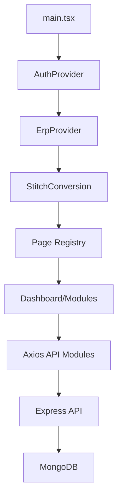
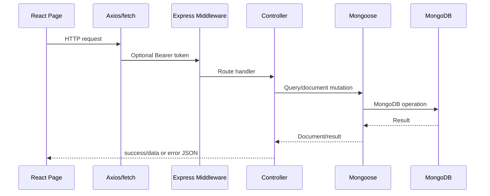
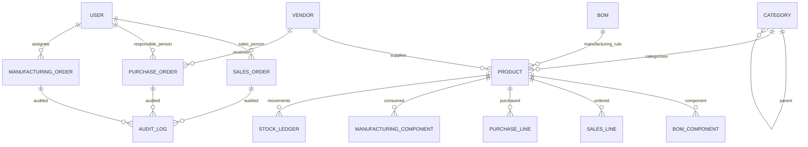
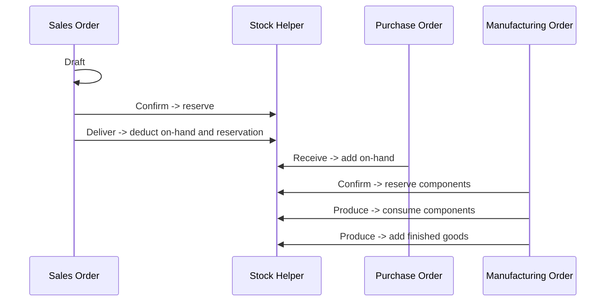

# Mini ERP (Nexus ERP) - Project Context

## Refactoring Record

### Structure changes

- Backend Express application configuration remains in `backend/app.js`, while `backend/server.js` now owns dotenv startup, MongoDB connection, and HTTP listener startup.
- Backend package scripts now start and run in development from `server.js`.
- Shared error handlers moved from `app.js` into `backend/middleware/error.middleware.js`.
- Shared role, status, and stock transaction constants were added under `backend/constants/`.
- Zod schema definitions were added under `backend/validators/request.schemas.js` for future validation; no routes were changed to enforce them.
- Service entry points were added under `backend/services/` for auth, stock, and audit responsibilities. Existing controllers now consume these service modules without moving or changing business algorithms.
- Backend smoke tests were added under `backend/tests/`.
- Frontend hook exports were added under `frontend/src/hooks/` so existing context hooks have a conventional import location. Existing context providers and module-specific files remain in place.
- A root `.gitignore` was added. `frontend/dist/`, `node_modules/`, environment files, coverage output, and logs are excluded.
- `backend/.env.example` was added. The existing `backend/.env` was untracked from Git and left physically unchanged.

### Old versus new backend entry flow

```text
Old:
backend/app.js -> dotenv -> connectDB -> configure Express -> listen

New:
backend/app.js -> configure/export Express application
backend/server.js -> dotenv -> connectDB -> app.listen
```

### Files moved

No existing source files were moved. This refactor extracted or added code instead of relocating modules, preventing unnecessary import churn and preserving the existing folder layout.

### Import paths updated

- Sales, purchase, manufacturing, and product controllers import stock operations from `backend/services/stock.service.js`.
- Sales, purchase, manufacturing, and BOM controllers import audit operations from `backend/services/audit.service.js`.
- Auth and user controllers import password/token operations from `backend/services/auth.service.js`.
- Mongoose models import shared enums from `backend/constants/`.

### Package script changes

- Backend `main`: `server.js`
- Backend `start`: `node server.js`
- Backend `dev`: `nodemon server.js`
- Backend `test`: `node --test tests/app.test.js`

### Root and environment changes

- Root `.gitignore` now ignores dependencies, build output, environment files, coverage, and logs.
- `.env.example` exceptions permit committing placeholder environment-variable names.
- `backend/.env` remains on disk but is no longer tracked.

### Intentionally not moved

- Frontend module folders remain under `frontend/src/modules/`.
- Frontend public assets remain under `frontend/public/` because Vite serves these as static public assets.
- Existing seed and synchronization scripts remain in `backend/`.
- Existing controllers remain in `backend/controllers/`; the task did not rewrite business logic or endpoints.
- Existing Mongoose schemas remain in `backend/models/` and were changed only to consume shared constants.

### Verification results

- Backend JavaScript syntax: passed for application source files.
- Backend smoke tests: 2 passed, 0 failed.
- Frontend build: blocked by 3 pre-existing TypeScript errors in `frontend/src/modules/purchase/pages/PurchaseOrderDetailPage.tsx` at lines 179, 189, and 193 where `activeOrder` is possibly undefined.
- Frontend lint: blocked because the repository has no ESLint flat configuration (`eslint.config.js` or `eslint.config.mjs`). No unrelated lint fixes were made.
- Backend startup is now divided between `app.js` and `server.js`; package scripts use `server.js`.

## 1. Project Overview

- **Project name:** Mini ERP 2.0 / Nexus ERP
- **Business purpose:** Provide a lightweight ERP workspace for products, inventory, sales, purchasing, manufacturing, bills of materials, users, and audit records.
- **Business problem addressed:** Centralize basic order and stock operations for a small or medium business, including draft-to-confirmed order lifecycles, stock reservations and movements, and manufacturing consumption/production.
- **Main implemented areas:**
  - JWT login and registration
  - Product and category management
  - Vendor management
  - Sales order draft, confirmation, delivery, cancellation
  - Purchase order draft, confirmation, receipt, cancellation
  - Bill of Materials
  - Manufacturing order draft, confirmation, start, progress, production, cancellation
  - Inventory and stock ledger
  - Audit logs
  - Dashboard metrics
  - Browser-generated PDF invoices/PO-style documents
- **Current development status:** Prototype/MVP. Core MongoDB-backed CRUD and lifecycle APIs exist, and most navigation pages are wired. Several screens use mocked or hard-coded display values, some actions do not call the backend, and the frontend currently fails to complete a production build.

## 2. Technology Stack

| Area | Technology |
|---|---|
| Frontend | React 18, TypeScript, Vite |
| Backend | Node.js, Express 5 |
| Database | MongoDB |
| ODM | Mongoose 9 |
| Authentication | bcryptjs and JWT (jsonwebtoken) |
| State management | React Context plus Zustand |
| Styling | Tailwind CSS 3, PostCSS, custom utility helpers |
| API communication | Axios and native `fetch` |
| UI libraries | Framer Motion, Lucide React, React Hot Toast |
| PDF generation | jsPDF and jsPDF-AutoTable |
| Validation | Mongoose schema validation; Zod is installed but not used by application source |
| Development tools | Vite, TypeScript 5.6, ESLint, Nodemon |

## 3. Complete Project Structure

```text
mini-erp/
|-- README.md
|-- PROJECT_CONTEXT.md
|-- backend/
|   |-- app.js                         # Express setup and route registration
|   |-- package.json
|   |-- package-lock.json
|   |-- .env                           # Local environment configuration
|   |-- seed.js                        # Creates default ADMIN
|   |-- seedData.js                    # Full demo data reset/seed
|   |-- sync.js                        # Rebuilds missing stock ledger entries
|   |-- config/
|   |   `-- db.js                      # MongoDB connection
|   |-- controllers/                   # Request/response and business logic
|   |-- middleware/                    # JWT protection and role authorization
|   |-- models/                        # Mongoose schemas
|   |-- routes/                        # Express route definitions
|   `-- utils/
|       |-- auditLogHelper.js          # Normal audit model helpers
|       |-- createAuditLog.js          # Legacy auth audit helper
|       |-- generateToken.js           # JWT generation
|       `-- stockHelper.js             # Stock and reservation helpers
`-- frontend/
    |-- index.html
    |-- package.json
    |-- package-lock.json
    |-- vite.config.ts
    |-- tailwind.config.js
    |-- postcss.config.js
    |-- tsconfig*.json
    |-- public/images/
    `-- src/
        |-- App.tsx                    # ERP and Stitch wrapper
        |-- main.tsx                  # React entry point and providers
        |-- StitchConversion.tsx      # Page state and authentication redirect
        |-- api/                      # Axios API modules
        |-- components/common/         # Reusable pagination/loading
        |-- components/layout/         # Sidebars, headers, profile drawer
        |-- config/pageRegistry.ts     # Page ID/component registry
        |-- constants/navigation.ts    # ERP navigation
        |-- constants/options.ts       # Filter options
        |-- context/AuthContext.tsx    # Authentication state
        |-- context/ErpContext.tsx     # ERP data loading and actions
        |-- lib/utils.ts               # Tailwind class helper
        |-- modules/                   # Feature pages/components
        |-- pages/auth/                # Login, signup, password reset UI
        |-- store/useAuthStore.ts      # Zustand auth/profile state
        |-- types/                     # Frontend domain/type definitions
        `-- utils/pdfGenerator.ts      # Browser PDF generation
```

Generated `node_modules/`, build output, and lockfiles are present in the workspace but are not application source responsibilities.

## 4. Application Architecture

### 4.1 Frontend Architecture

The frontend is a single-page application. It uses internal React state for navigation rather than a URL router. `StitchConversion` holds `activePage`, maps it through `pageRegistry`, and redirects unauthenticated users to login.

Two data providers exist:

- `AuthProvider` owns login/signup/logout UI state.
- `ErpProvider` loads products, sales, purchase, manufacturing, BOM, and stock-ledger data and exposes mutations.

Zustand provides a separate `useAuthStore`, currently not fully synchronized with `AuthContext`.



### 4.2 Backend Architecture

The backend follows a route -> controller -> Mongoose model structure. Several routes do not enforce middleware, while auth, user writes, and audit logs do. Controllers contain most business logic; no separate service layer is implemented.



### 4.3 Authentication flow

1. Login POST sends email/password.
2. Backend finds user and validates bcrypt password.
3. Backend signs a 7-day JWT containing the user ID.
4. Frontend stores the token under `token` in `localStorage`.
5. Axios adds `Authorization: Bearer <token>` to requests.
6. Protected middleware verifies JWT and loads `req.user`.

There is no refresh-token flow and no server-side logout/session invalidation.

## 5. Database Design

### 5.1 `User`

- `name`: String, required, trim
- `email`: String, required, unique, lowercase, trim
- `password`: String, required, minimum 6 characters
- `role`: Enum `ADMIN`, `SALES_USER`, `PURCHASE_USER`, `MANUFACTURING_USER`, `INVENTORY_MANAGER`, `BUSINESS_OWNER`; default `SALES_USER`
- Timestamps

### 5.2 `Product`

- `name`: String, required
- `sku`: String, unique, uppercase, trim, not required
- `category_id`: ObjectId -> `Category`
- `sales_price`, `cost_price`: Number, default 0, minimum 0
- `image.filename`: String, default `listingimage`
- `image.url`: String, required/default; default is an Unsplash URL
- `on_hand_qty`: Number, default 0, minimum 0
- `reserved_qty`: Number, default 0, minimum 0
- `low_stock_threshold`: Number, default 0, minimum 0
- `procure_on_demand`: Boolean, default false
- `procurement_type`: Enum `purchase`, `manufacturing`, required if on-demand
- `procurement_strategy`: Enum `MTS`, `MTO`, default `MTS`
- `vendor_id`: ObjectId -> `Vendor`, required for on-demand purchase
- `bom_id`: ObjectId -> `Bom`, required for on-demand manufacturing
- `is_active`: Boolean, default true
- Virtual `free_qty` = on-hand minus reserved
- Timestamps

### 5.3 `Category`

- `name`: required, unique, trim
- `description`: optional trim
- `parent_category_id`: ObjectId -> `Category`, default null
- Timestamps

### 5.4 `Vendor`

- `name`: required, trim
- `vendor_address`: optional, max 500
- `responsible_person`, `email`, `phone`: optional trim
- `email` lowercased
- `is_active`: Boolean, default true
- Timestamps

### 5.5 `SalesOrder`

- `so_number`: required, unique
- `customer`: required, trim
- `customer_address`: optional, max 500
- `creation_date`: Date, default now
- `sales_person`: ObjectId -> `User`
- `status`: enum `Draft`, `Confirmed`, `Partially Delivered`, `Fully Delivered`, `Cancelled`; default `Draft`
- `products[]`: at least one line
  - `product_id` required -> `Product`
  - `product_name` required
  - `availability` number default 0
  - `ordered_quantity` required, minimum 0.01
  - `delivered_quantity` default 0
  - `units` default `Units`
  - `sales_unit_price` required, minimum 0
  - Virtual `total`
- Schema virtual `total`
- Timestamps

### 5.6 `PurchaseOrder`

- `po_number`: required, unique
- `vendor_id`: required -> `Vendor`
- `vendor_name`, `vendor_address`
- `responsible_person`: ObjectId -> `User`
- `creation_date`: Date default now
- `status`: enum `Draft`, `Confirmed`, `Partially Received`, `Fully Received`, `Cancelled`; default `Draft`
- `auto_generated`: Boolean default false
- `source_reference`: String/null
- `products[]`: at least one line
  - `product_id` required -> `Product`
  - `product_name` required
  - `ordered_quantity` minimum 0.01
  - `received_quantity` default 0
  - `units` default `Units`
  - `cost_price` required, minimum 0
- Timestamps

### 5.7 `Bom`

- `bom_number`: required, unique
- `finished_product_id`: required -> `Product`
- `finished_product_name`: required
- `quantity`: required, minimum 0.01
- `units`: default `Units`
- `reference`: optional, max 8
- `components[]`: at least one
  - `component_product_id` -> `Product`, required
  - `component_name`, required
  - `to_consume_qty`, minimum 0.01
  - `units`, default `Units`
- `operations[]`
  - `operation_name`, required
  - `work_center`, required
  - `expected_duration`, required, minimum 1
- `is_active`, default true
- Timestamps

### 5.8 `ManufacturingOrder`

- `mo_number`: required, unique
- `finished_product_id`: required -> `Product`
- `finished_product_name`: required
- `quantity`: required, minimum 0.01
- `units`: default `Units`
- `creation_date`, `schedule_date`
- `assignee`: ObjectId -> `User`
- `bom_id`: ObjectId -> `Bom`, default null
- `status`: enum `Draft`, `Confirmed`, `In Progress`, `Done`, `Cancelled`
- `components[]`
  - `product_id` -> `Product`
  - `product_name`
  - `availability`
  - `to_consume_qty`
  - `consumed_qty`
  - `units`
- `operations[]`
  - `operation_name`, `work_center`
  - `expected_duration`, minimum 0
  - `real_duration`, default 0
- Timestamps

### 5.9 `StockLedger`

- `product_id`: required -> `Product`
- `transaction_type`: enum purchase receipt, sales delivery, manufacturing produce/consume, manual adjustment
- `quantity`: signed or positive depending on movement
- `balance_after`
- `reference_type`: enum `SalesOrder`, `PurchaseOrder`, `ManufacturingOrder`, `Manual`
- `reference_id`: ObjectId
- `notes`
- `created_by`: ObjectId -> `User`, nullable
- Compound index `{ product_id: 1, createdAt: -1 }`

### 5.10 Audit Log

There are two audit implementations:

1. **`auditLog.model.js` / `AuditLog` collection:** module enum Sales/Purchase/Manufacturing/Product/BoM; record_id; record_reference; action; optional field_changed/old_value/new_value; user reference; timestamps; compound index module+record+time.
2. **`AuditLog.js` / `AuditLogLegacy`:** userId, action, entity, entityId, timestamps. Used only by auth registration/login.

### 5.11 `Counter`

- `_id`: String
- `seq`: Number
- Used to generate sequential SO/PO/MO/BOM references.



## 6. Authentication & Authorization

### Implemented

- Public registration: `POST /api/auth/register`
- Public login: `POST /api/auth/login`
- Protected profile: `GET /api/auth/me`
- bcrypt password hashing (`bcrypt.hash`), including seed scripts
- bcrypt password comparison
- JWT with 7-day expiry
- Bearer header protection
- Role enum and `authorize(...roles)` middleware
- Admin-only user writes and audit-log reads
- Authenticated reads for user list/detail

### Protected route matrix

| Area | Protection |
|---|---|
| `/api/auth/me` | JWT |
| `/api/users` | JWT; writes additionally ADMIN |
| `/api/audit-logs` | JWT + ADMIN |
| Products, categories, inventory, stock ledger, sales, purchases, manufacturing, BOMs, vendors, dashboard | No route middleware |

### Not implemented

- Refresh token
- Server-side logout
- Forgot-password backend
- Token revocation
- Fine-grained field/operation permissions
- Permission persistence
- Frontend route guards based on role
- Client restoration of authenticated state after page reload

The frontend role toggle and permission matrix are visual controls, not authorization enforcement.

### Security gaps

- Local `.env` is committed/workspace-present with development values. It must remain uncommitted or be replaced with environment secrets.
- Public registration accepts a `role` field in the backend controller even though normal frontend registration omits it.
- Most mutation APIs are unauthenticated.
- CORS allows all origins.
- No rate limiting.
- No request body schema validation through Zod.
- JWT secret and database URI are environment-based but should be strong and environment-specific.
- Password reset UI only calls `alert()` and performs no API operation.

## 7. Backend API Documentation

Base URL: `http://localhost:5000/api`.

Error formats vary; controllers generally return `{ success: false, message }`, auth controllers return `{ message }`, and the global handler returns `{ success: false, message }`.

### Auth and users

| Method | Endpoint | Controller | Auth | Body/parameters | Response |
|---|---|---|---|---|---|
| POST | `/auth/register` | `register` | No | `name`, `email`, `password`, optional `role` | 201 `{ message, user }`; 400 duplicate; 500 |
| POST | `/auth/login` | `login` | No | `email`, `password` | 200 `{ message, token, user }`; 400 invalid |
| GET | `/auth/me` | `getMe` | Bearer | None | 200 req.user |
| GET | `/users` | `getUsers` | Bearer | None | `{ success, data }` |
| GET | `/users/:id` | `getUserById` | Bearer | path id | `{ success, data }` or 404 |
| POST | `/users` | `createUser` | Bearer + ADMIN | `name`, `email`, optional `password`, `role` | 201 wrapped user |
| PUT | `/users/:id` | `updateUser` | Bearer + ADMIN | `name`, `email`, `role` | wrapped user |
| DELETE | `/users/:id` | `deleteUser` | Bearer + ADMIN | path id | wrapped success |

### Products and categories

| Method | Endpoint | Controller | Auth | Parameters/body | Response/status |
|---|---|---|---|---|---|
| POST | `/products` | `createProduct` | None | Product fields | 201 `{ success, data }`; 400 |
| GET | `/products` | `getProducts` | None | `search`, `category_id`, `page`, `limit` | Wrapped paginated list |
| GET | `/products/:id` | `getProductById` | None | path id | Wrapped product/404 |
| PUT | `/products/:id` | `updateProduct` | None | Product fields | Wrapped product/400/404 |
| DELETE | `/products/:id` | `deleteProduct` | None | path id | Message/404/500 |
| POST | `/categories` | `createCategory` | None | Category fields | 201/wrapped |
| GET | `/categories` | `getCategories` | None | None | Wrapped category array |
| GET | `/categories/:id` | `getCategoryById` | None | path id | Wrapped/404 |
| PUT | `/categories/:id` | `updateCategory` | None | Category fields | Wrapped/400/404 |
| DELETE | `/categories/:id` | `deleteCategory` | None | path id | Message/404/500 |

### Inventory

| Method | Endpoint | Controller | Auth | Parameters/body | Response |
|---|---|---|---|---|---|
| GET | `/inventory` | `getInventoryDashboard` | None | None | Totals and stock summary |
| GET | `/inventory/dashboard` | `getInventoryDashboard` | None | None | Same |
| GET | `/inventory/low-stock` | `getLowStockAlerts` | None | None | Low-stock product array |
| GET | `/stock-ledger` | `getStockLedger` | None | `page`, `limit`, `product_id`, `transaction_type` | Paginated ledger |
| GET | `/stockLedger` | Same router | None | Legacy alias | Same route behavior |
| GET | `/stock-ledger/:productId` | `getStockLedgerByProduct` | None | path product id | Ledger array |
| POST | `/stock-ledger/adjustment` | `createManualAdjustment` | None | `product_id`, `quantity`, `notes`, optional `created_by` | 201 wrapped movement |

### Sales

| Method | Endpoint | Controller | Auth | Parameters/body | Status behavior |
|---|---|---|---|---|---|
| POST | `/sales` | `createSalesOrder` | None | `customer`, `customer_address`, `sales_person`, `products[]` | Creates Draft |
| GET | `/sales` | `getSalesOrders` | None | `search`, `status`, `page`, `limit` | Paginated |
| GET | `/sales/:id` | `getSalesOrderById` | None | path id | Detail with computed availability |
| PUT | `/sales/:id` | `updateSalesOrder` | None | mutable fields/products | Draft only |
| DELETE | `/sales/:id` | `deleteSalesOrder` | None | path id | Draft only |
| POST | `/sales/:id/confirm` | `confirmSalesOrder` | None | path id | Draft -> Confirmed, reserves quantities |
| POST | `/sales/:id/deliver` | `deliverSalesOrder` | None | `products[{ product_id, delivered_quantity }]` | Confirmed/partial -> delivered status |
| POST | `/sales/:id/cancel` | `cancelSalesOrder` | None | path id | Releases reservations when confirmed/partial |

### Purchases

| Method | Endpoint | Controller | Auth | Parameters/body | Status behavior |
|---|---|---|---|---|---|
| POST | `/purchase` | `createPurchaseOrder` | None | `vendor_id`, `responsible_person`, `products[]`, optional auto fields | Creates Draft |
| GET | `/purchase` | `getPurchaseOrders` | None | `search`, `status`, `page`, `limit` | Paginated |
| GET | `/purchase/:id` | `getPurchaseOrderById` | None | path id | Detail |
| PUT | `/purchase/:id` | `updatePurchaseOrder` | None | vendor/responsible/products | Draft only |
| DELETE | `/purchase/:id` | `deletePurchaseOrder` | None | path id | Draft only |
| POST | `/purchase/:id/confirm` | `confirmPurchaseOrder` | None | path id | Draft -> Confirmed |
| POST | `/purchase/:id/receive` | `receivePurchaseOrder` | None | `products[{ product_id, received_quantity }]` | Partial/full receipt |
| POST | `/purchase/:id/cancel` | `cancelPurchaseOrder` | None | path id | Cancel unless fully received |

### Manufacturing and BOM

| Method | Endpoint | Controller | Auth | Parameters/body | Status |
|---|---|---|---|---|---|
| POST | `/manufacturing` | `createManufacturingOrder` | None | finished product, quantity, BOM/manual components/operations | Draft |
| GET | `/manufacturing` | `getManufacturingOrders` | None | `search`, `status`, `page`, `limit` | Paginated |
| GET | `/manufacturing/:id` | `getManufacturingOrderById` | None | path id | Detail |
| PUT | `/manufacturing/:id` | `updateManufacturingOrder` | None | Draft fields/components/operations | Draft only |
| DELETE | `/manufacturing/:id` | `deleteManufacturingOrder` | None | path id | Draft only |
| POST | `/manufacturing/:id/confirm` | `confirmManufacturingOrder` | None | path id | Confirm + reserve components |
| POST | `/manufacturing/:id/start` | `startManufacturingOrder` | None | path id | Confirmed -> In Progress |
| PUT | `/manufacturing/:id/progress` | `updateManufacturingProgress` | None | components consumed quantities, operation durations | Confirmed/In Progress |
| POST | `/manufacturing/:id/produce` | `produceManufacturingOrder` | None | optional body, uses line consumed values | Done, consumes components, adds output |
| POST | `/manufacturing/:id/cancel` | `cancelManufacturingOrder` | None | path id | Releases component reservations |
| POST | `/boms` | `createBom` | None | finished product, quantity, components, operations | 201 |
| GET | `/boms` | `getBoms` | None | `search`, `page`, `limit` | Paginated |
| GET | `/boms/:id` | `getBomById` | None | path id | Detail |
| PUT | `/boms/:id` | `updateBom` | None | BOM fields/components/operations | Wrapped |
| DELETE | `/boms/:id` | `deleteBom` | None | path id | Wrapped message |

### Vendors, dashboard, audit

| Method | Endpoint | Controller | Auth | Parameters/body | Response |
|---|---|---|---|---|---|
| POST | `/vendors` | `createVendor` | None | Vendor fields | 201 wrapped |
| GET | `/vendors` | `getVendors` | None | `search` | Wrapped array |
| GET | `/vendors/:id` | `getVendorById` | None | path id | Wrapped/404 |
| PUT | `/vendors/:id` | `updateVendor` | None | Vendor fields | Wrapped |
| DELETE | `/vendors/:id` | `deleteVendor` | None | path id | Wrapped message |
| GET | `/dashboard` | `getDashboardMetrics` | None | None | Sales/purchase/manufacturing/inventory metrics |
| GET | `/audit-logs` | `getAuditLogs` | Bearer + ADMIN | `module`, `record_id` or `recordId`, `page`, `limit` | Normal audit records |

## 8. Frontend Documentation

### Pages

| Page ID | Page | API-backed status |
|---|---|---|
| `login` | Login | Functional against `/auth/login` |
| `signup` | Registration | Functional against `/auth/register` |
| `forgot-password` | Reset UI | NOT IMPLEMENTED backend/action |
| `dashboard` | Dashboard module cards | Functional metric fetch |
| `products` | Product list | Functional list and detail navigation |
| `product-detail` | Product create/edit form | Partially functional create/update |
| `inventory` | Inventory overview | Functional through ERP data refresh |
| `stock-ledger` | Ledger display | Functional list data |
| `sales` | Sales list | Functional list |
| `sales-order-create` | Sales creation | Functional create |
| `sales-order-detail` | Sales detail/actions/PDF | Partially functional confirm/deliver/cancel/PDF |
| `purchase` | Vendor hub | Vendor fetch functional; metrics partly hard-coded |
| `purchase-order-detail` | PO create/detail/actions/PDF | Partially functional |
| `manufacturing` | MO Kanban/list | Functional list and basic transitions |
| `mo-form` | MO create/detail | Partially functional |
| `bom` | BOM list | Functional list |
| `bom-detail` | BOM detail | Read/display mostly local only; save/add/delete not backend-wired |
| `audit-logs` | Audit log table | Functional for normal audit model and ADMIN |
| `user-management` | User list | Functional fetch |
| `user-management-detail` | User/profile and permission mock | Partial; permissions are static mock text |

### State and integration

- `ErpContext` fetches ERP collections concurrently on mount.
- Axios unwraps `{ success, data }` responses to `data`.
- For audit and detail pages, direct fetch/axios calls bypass or supplement the context.
- Loading states, toast notifications, and error text are partially implemented.
- `localStorage` stores JWT and temporary PO vendor selection.
- No React Router or browser URL state is used.

## 9. ERP Business Modules

| Module | Implementation | Missing/known issue |
|---|---|---|
| User Management | DB roles, user CRUD, login. Admin-only writes. | Frontend detail is not connected to role permission updates; public signup and role matrix are incomplete |
| Product Management | CRUD, SKU, prices, stock, procurement fields | Create initial stock bugs; update stock semantics unclear; category/vendor options incomplete |
| Inventory Management | On-hand/reserved/free quantities and low stock | No warehouse/location model or multi-location inventory |
| Sales Management | Create, edit Draft, confirm, reserve, deliver, cancel | No transaction atomicity, partial UI mapping, no customer master |
| Purchase Management | Create, edit Draft, confirm, receive, cancel | No transaction atomicity, receive UI sends full quantities |
| Customer Management | Free-text customer fields on sales order | NOT IMPLEMENTED as a customer model/module |
| Vendor Management | Vendor CRUD and PO relation | No vendor rating, payment terms, or full frontend CRUD |
| Bill of Materials | BOM CRUD, components, operations | Frontend detail save/edit not API-wired |
| Manufacturing Management | MO lifecycle and stock movements | No real work-order creation, no component availability validation, weak transaction safety |
| Work Orders | Operations embedded in BOM/MO | NOT IMPLEMENTED as separate persisted work-order records |
| Work Centers | Free-text work center names; seed/UI cards | NOT IMPLEMENTED as managed model/API |
| Procurement Automation | Product procurement fields and PO/MO fields | No shortage-triggered automatic PO/MO generation |
| MTS | `procurement_strategy: MTS` field | UI field exists; no complete planning workflow |
| MTO | `procurement_strategy: MTO` field | UI field exists; no complete MTO order trigger workflow |
| Stock Ledger | Movement entries and detail | No transaction rollback; manual adjustment is implemented |
| Audit Logs | Normal model audit helper | Two inconsistent log models; field and status actions partly used |
| Dashboard | Backend metrics and frontend cards | Some metrics/cards use hard-coded or approximate values |

## 10. Business Logic & Workflows

### Product creation

`createProduct` creates the product first. If `on_hand_qty > 0`, it calls `recordStockMovement`, which adds the quantity to the product again and creates a manual-adjustment ledger entry. This creates a double initial-stock bug.

### Stock quantity updates

`recordStockMovement` finds product, calculates `on_hand_qty + quantity`, rejects a negative resulting balance, saves product, and creates ledger entry. It does not use a MongoDB transaction or session.

### Sales confirmation

`confirmSalesOrder` loads a Draft order, compares each ordered quantity to free stock, collects shortages, increments `reserved_qty` for every line, changes status to Confirmed, and writes status audit logs. The returned shortages do not prevent confirmation. Reservation may exceed physical stock.

### Sales delivery

`deliverSalesOrder` accepts cumulative delivered quantities. It rejects decreases and over-delivery, deducts the delta from on-hand stock, releases the same delta from reservations, updates the line and status. Partial/fully delivered determination is based on exact totals.

### Sales cancellation

For Confirmed or Partial-Delivered sales, remaining quantities are released from reservations. It does not create an inventory movement.

### Purchase creation and receipt

Purchase creation resolves vendor and product names and creates a Draft with sequential PO number. Receipt accepts cumulative received quantities, increments on-hand stock for the delta, creates ledger entries, and sets partial/full status.

### Manufacturing creation

An MO can use a BOM or manually supplied components/operations. A BOM scales component quantities and operation durations by `MO quantity / BOM quantity`.

### Manufacturing confirmation

Confirmation requires at least one component and reserves each `to_consume_qty`. It does not verify that free stock covers the reservation.

### Manufacturing progress

Draft/confirmed/in-progress component consumed quantities and operation durations can be updated. There is no validation that consumed quantity is less than/equal to required quantity or that production has started appropriately.

### Production completion

Production releases all component reservations, consumes either a supplied consumed quantity or the required quantity, adds ledger rows, adds quantity of finished goods, and sets Done.

### Procurement triggering

Product fields describe purchase/manufacturing procurement and MTS/MTO, but no shortage-triggered workflow exists. `procure_on_demand` is not used to auto-create a PO or MO.



## 11. Error Handling & Validation

- Express has a 404 handler and final global error handler.
- Global handler logs errors and returns 500 unless `err.status` exists.
- Most controllers catch exceptions and return their own 400/404/500 JSON.
- Mongoose handles required/enum/min/unique validation.
- Custom pre-validate logic validates procurement dependencies.
- Sales and PO schema require at least one line.
- Frontend forms perform basic required-field and positive quantity checks.
- Axios response interceptors unwrap and normalize success/error messages.
- React Hot Toast provides many mutation errors.
- Missing:
  - Zod/central request validation
  - MongoDB sessions/transactions
  - consistent auth error shape
  - centralized controller error class
  - stale-token logout
  - backend ownership checks
  - comprehensive numeric and ID validation

## 12. Environment & Project Setup

Environment variable names used by backend:

- `PORT`
- `MONGO_URI`
- `JWT_SECRET`

A local backend `.env` exists. Values are intentionally omitted from this document.

### Backend

```bash
cd backend
npm install
npm run dev
```

Production-style start:

```bash
npm start
```

Database seed:

```bash
node seed.js
node seedData.js
node sync.js
```

`seedData.js` destructively drops selected demo collections. It is for disposable demo databases only.

### Frontend

```bash
cd frontend
npm install
npm run dev
npm run build
npm run lint
npm run preview
```

The frontend currently uses a hard-coded backend origin, `http://localhost:5000/api`.

## 13. Current Issues & Bugs

| Severity | File/function | Problem | Suggested fix |
|---|---|---|---|
| Critical | `backend/controllers/product.controller.js:createProduct` | Product created with initial `on_hand_qty`, then stock helper adds it again; double counts stock | Set initial qty 0 before ledger or make helper create initial ledger without changing quantity |
| Critical | Sales/PO/MO stock controllers | Multi-document updates have no MongoDB transaction | Use sessions and atomic transactions |
| High | `backend/routes/*.js` | Core CRUD and lifecycle routes have no authentication | Apply protect middleware and suitable role middleware |
| High | `backend/controllers/auth.controllers.js/register` | Direct public registration can supply role | Ignore client role and assign default/ADMIN only through protected admin flow |
| High | `frontend/src/modules/purchase/pages/PurchaseOrderDetailPage.tsx:179,189,193` | `activeOrder` treated as possibly undefined; frontend build fails | Guard activeOrder or return early/new-PO branch |
| High | `backend/controllers/salesOrder.controller.js:confirmSalesOrder` | Reservation may exceed free stock; shortages are informational only | Reject confirmation or start shortage/procurement workflow |
| High | `backend/controllers/manufacturingOrder.controller.js:confirmManufacturingOrder` | Reserves component quantities without available-stock check | Validate free stock before reservation |
| High | `frontend/src/context/ErpContext.tsx:mapManufacturingOrder` | Maps In Progress to Confirmed | Preserve/display In Progress and Done statuses correctly |
| High | `frontend/src/modules/manufacturing/pages/MOFormPage.tsx` | `handleProduce` starts MO, while `handleMarkDone` performs production | Clarify UI labels: Produce should be start, Mark Done should be produce |
| Medium | `backend/models/AuditLog.js` and `auditLog.model.js` | Two differently shaped audit models/names | Consolidate to one model and migration strategy |
| Medium | `frontend/src/modules/manufacturing/pages/BOMDetailPage.tsx` | Save/add/delete actions are toast-only | Call bomApi create/update and remove operations if unsupported |
| Medium | `frontend/src/modules/purchase/pages/PurchasePage.tsx` | Lead time and quality rating are hard-coded | Source from real vendor data or mark as unimplemented |
| Medium | `frontend/src/modules/sales/pages/SalesOrderCreatePage.tsx` | Customer/sales rep are local mock arrays | Implement customer/user selection from APIs |
| Medium | `frontend/src/modules/users/pages/UserManagementDetailPage.tsx` | Permission tables are static text | Persist permission model and enforce backend role/permission checks |
| Medium | `frontend/src/pages/auth/ForgotPasswordPage.tsx` | Reset is an alert only | Implement reset API and verification flow |
| Medium | `frontend/src/context/AuthContext.tsx` | Role toggle/backend role mismatch | Use backend role from login response |
| Medium | `frontend/src/store/useAuthStore.ts` | Separate auth store does not restore state/profile consistently | Establish one auth source or synchronize at login reload |
| Medium | `frontend/src/api/client.ts` | Hard-coded localhost API origin | Use Vite environment variable |
| Medium | `frontend/src/modules/purchase/pages/PurchasePage.tsx` | axios unwraps `/vendors` then code maps response; likely works with interceptor but should have type guards | Add explicit API result typing |
| Medium | `frontend/src/modules/manufacturing/pages/MOFormPage.tsx` | Native fetch `/api/manufacturing/:id` misses configured `/api` origin and Vite proxy | Use manufacturingApi/get detail |
| Medium | `frontend/src/utils/pdfGenerator.ts` | PDF label says Tax (10%) while sales UI uses 18% | Centralize tax rule or remove implied tax |
| Medium | `backend/controllers/dashboard.controller.js` | Dashboard uses statuses `Completed` and `Partially Processed` not present in schemas | Use `Fully Delivered`, `Fully Received`, `Done`, `Partially Received` |
| Medium | `backend/controllers/salesOrder.controller.js` and PO | Confirmed line shortages/receipts lack sessions and idempotency | Validate and make transitions idempotent/transactional |
| Medium | `backend/routes/stockLedger.routes.js` | Product route and adjustment route do not conflict method-wise, but path semantics can be ambiguous in future | Put `/adjustment` before `/:productId` as GET/POST distinct still safe |
| Low | `frontend/src/modules/users/pages/UserManagementDetailPage.tsx` | Mojibake text and encoding symbols appear | Replace broken characters and use constants |
| Low | `frontend/src/modules/dashboard/pages/DashboardPage.tsx` | Filter clicks only show toast | Implement status filtering/navigation |
| Low | `frontend/src/modules/audit/pages/AuditLogsPage.tsx` | Filter options and filter state UI are not wired | Wire filters to backend query params |
| Low | Duplicate `audit-logs` PageId entries | Duplicate union entries | Remove duplicates |
| Low | `README.md` | Structure references `final-work/` and generic setup; may be stale | Align README with actual repository |

## 14. Missing Features & Technical Debt

### Fundamental

- Authentication protection on core CRUD routes
- Frontend build repair
- MongoDB transactions
- Correct initial stock handling
- Real customer master
- Real vendor UI CRUD
- BOM create/update UI
- Server-side password reset
- Central API configuration
- Consistent API response shape and validation

### Medium

- Role/permission persistence and enforcement
- Procurement triggers and shortage planning
- True MTS/MTO workflows
- Purchase/sales editing after confirmation
- Backend audit for product, category, vendor, and inventory adjustments
- Warehouse and bin/location support
- Serial/batch/expiry support
- Multi-currency and tax configuration
- File storage for images/attachments
- Automated tests
- Seed isolation and migrations

### Advanced

- MRP calculation and planned orders
- Work center and routing master
- Separate work-order execution
- Reorder point automation
- Demand forecasting
- Multi-warehouse and inter-warehouse transfer
- Invoice/payments/returns
- Procurement analytics and supplier scorecards
- Reporting and exports
- Notifications
- Realtime inventory updates
- Role audit and security monitoring

## 15. Development Roadmap

1. **Fix build blockers:** resolve three active purchase-detail TS errors and run full build/lint.
2. **Fix stock correctness:** product initial stock, confirmation reservations, and transaction safety.
3. **Secure APIs:** protect core routes, enforce role matrix, stop public role escalation.
4. **Fix audit model duplication:** standardize audit logs and auth audit entries.
5. **Repair data mapping:** status, role, PO detail, MO status, and frontend/backend field alignment.
6. **Complete core CRUD:** category/vendor/user/BOM frontend integration.
7. **Add customers:** create Customer model, API, and sales relation.
8. **Add transactions:** stock, sales, purchase, manufacturing mutations.
9. **Implement procurement:** shortage detection and PO/MO proposal generation.
10. **Complete frontend workflows:** password reset, real permissions, real dashboard, tests.
11. **Add ERP scaling features:** work centers, work orders, warehouses, batch/serial tracking.

## 16. Important File Reference

| File | Responsibility | Related Module |
|---|---|---|
| `backend/app.js` | Express setup/routes/global handlers | Cross-cutting |
| `backend/config/db.js` | MongoDB connection | Database |
| `backend/controllers/*` | Business logic and API responses | All backend modules |
| `backend/routes/*` | Endpoint-to-controller mappings | All backend modules |
| `backend/models/*` | Mongoose schemas | Database |
| `backend/utils/stockHelper.js` | Stock movement/reservation helpers | Inventory/Sales/MO |
| `backend/utils/auditLogHelper.js` | Normal audit writes | Audit |
| `backend/middleware/auth.middleware.js` | JWT verification | Authentication |
| `backend/middleware/role.middleware.js` | Role authorization | Authorization |
| `backend/seed.js` | Default admin seed | Setup |
| `backend/seedData.js` | Demo data reset/seed | Setup/demo |
| `backend/sync.js` | Ledger backfill utility | Inventory |
| `frontend/src/main.tsx` | React/provider entry point | Frontend bootstrap |
| `frontend/src/StitchConversion.tsx` | Page state/auth redirect | Navigation |
| `frontend/src/config/pageRegistry.ts` | Page ID mapping | Frontend routing |
| `frontend/src/context/AuthContext.tsx` | Login/signup/logout state | Authentication |
| `frontend/src/context/ErpContext.tsx` | ERP fetching/actions/data mappers | Cross-module state |
| `frontend/src/api/client.ts` | Axios base/interceptors | API communication |
| `frontend/src/modules/products/pages/ProductsPage.tsx` | Product list | Products |
| `frontend/src/modules/sales/pages/*` | Sales list/create/detail | Sales |
| `frontend/src/modules/purchase/pages/*` | Vendor hub/PO detail | Purchase/vendor |
| `frontend/src/modules/manufacturing/pages/*` | MO/BOM screens | Manufacturing |
| `frontend/src/modules/inventory/pages/*` | Inventory/ledger | Inventory |
| `frontend/src/modules/audit/pages/AuditLogsPage.tsx` | Audit table | Audit |
| `frontend/src/modules/users/pages/*` | User management UI | Users |
| `frontend/src/utils/pdfGenerator.ts` | Browser PDF export | Sales/Purchase |

## 17. Final Project Status

**Overall completion estimate:** Approximately 35-40% of a complete Mini ERP (estimate only).

### Completed or strongly implemented

- MongoDB/Mongoose backend foundation
- Product, vendor, category, sales, purchase, BOM, MO, inventory, ledger, user, and dashboard APIs
- Core sales/purchase/manufacturing lifecycle state machines
- Basic JWT authentication
- React module pages and navigation
- Browser PDF generation
- Stock and normal audit ledger concepts

### Incomplete modules

- Customer management
- Complete vendor CRUD UI
- Complete BOM create/update UI
- Procurement automation
- Work center/work order masters
- Password reset
- Fine-grained RBAC
- Accurate permissions UI
- Test suite
- Multi-warehouse and advanced ERP automation

### Critical blockers

1. Frontend build failure
2. Core routes not protected
3. Initial stock counted twice
4. Stock mutations not transactional
5. Sales/MO confirmation can reserve unavailable stock
6. Public role escalation
7. Audit model duplication

### Top 10 priorities

1. Fix TypeScript build errors.
2. Fix initial product stock ledger behavior.
3. Add MongoDB sessions/transactions.
4. Protect core APIs and public role assignment.
5. Prevent negative stock/reserve over-capacity.
6. Consolidate audit models.
7. Repair status and role mappings.
8. Complete BOM create/update frontend integration.
9. Implement customer master and vendor UI CRUD.
10. Add baseline API/integration tests.

### Recommended next development task

Fix the frontend build and then repair stock correctness as a focused first implementation batch: product initial stock, sales reservation validation, manufacturing reservation validation, and MongoDB transaction use.
